# 实践课1：Pi Agent 安装与使用

本次实践在 Windows PowerShell 中完成，使用 Pi Agent v1.5.0，练习目录为 `pi-test`。任务一至五的记录对应 S1–S6，选做的 PPT Skill 对应 S7–S8。

## S1 本地安装并启动 Pi

使用官方 npm 包安装 Pi 到 `D:\workspace\pi`，随后在 `pi-test` 目录启动。S1 显示 Pi v1.5.0 和当前工作目录。

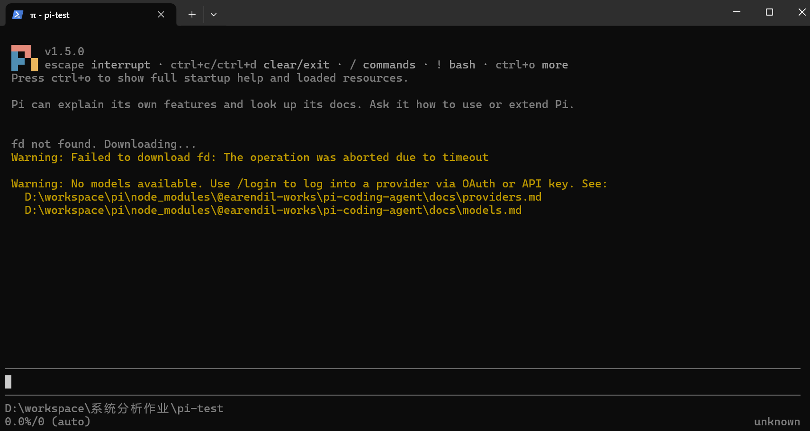

## S2 配置模型并完成对话

在 Pi 中通过 `/login` 配置 DeepSeek，随后发送「你好」。`deepseek-v4-pro` 回复「你好！有什么可以帮你的吗？」，确认模型可以正常对话。

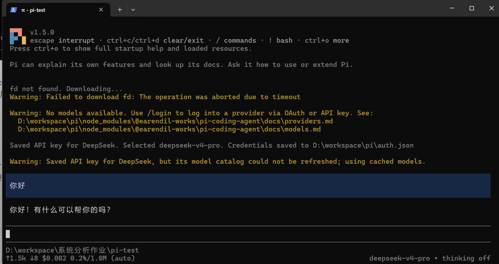

## S3 切换模型与思考级别

通过 `/model` 将模型从 `deepseek-v4-pro` 切换到 `deepseek-flash`，再将思考级别从 `off` 调为 `low`。两张截图记录了切换前后的状态。

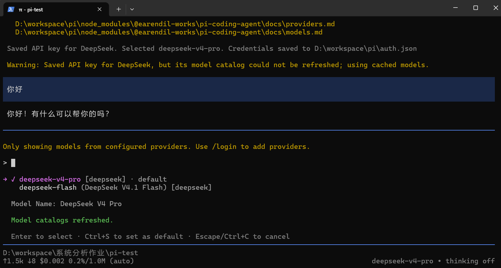

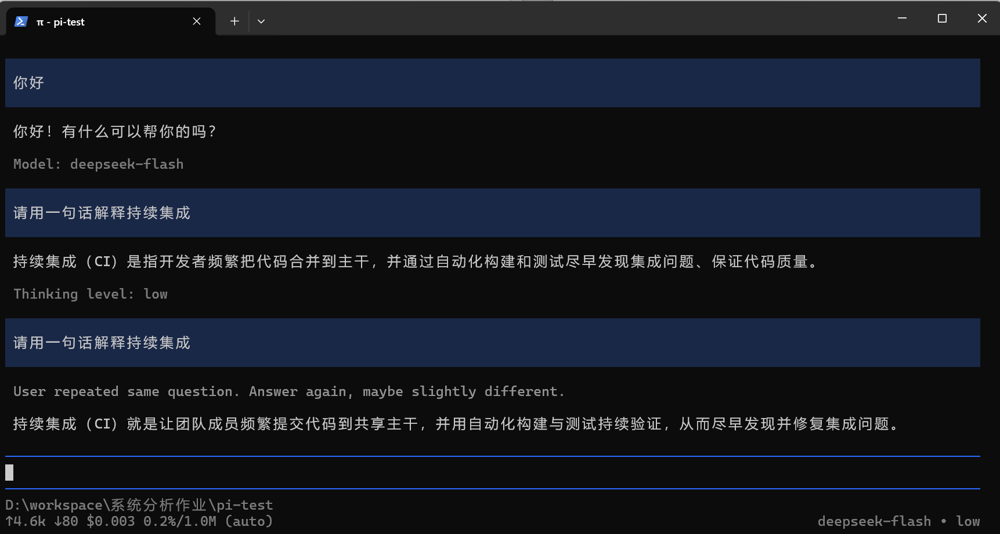

## S4 引用代码文件

在提示词中用 `@hello.py` 引用 [示例代码](hello.py)，请模型解释函数用途和运行结果。模型读取文件后说明 `add(a, b)` 返回两数之和，`print(add(2, 3))` 输出 `5`。

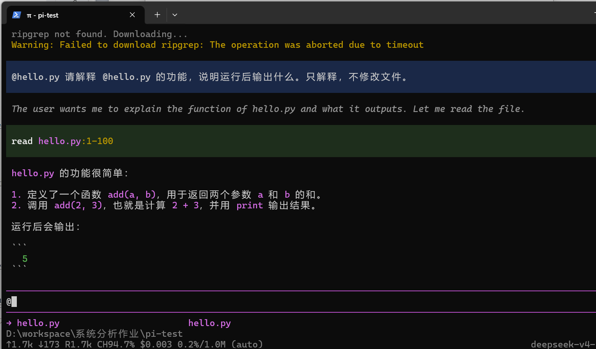

## S5 粘贴小图片并测试

使用 deepseek-flash 识别小图，回复指出蓝色正方形和黑色数字 7。现有截图记录了识图结果，剪贴板粘贴过程未清楚显示。

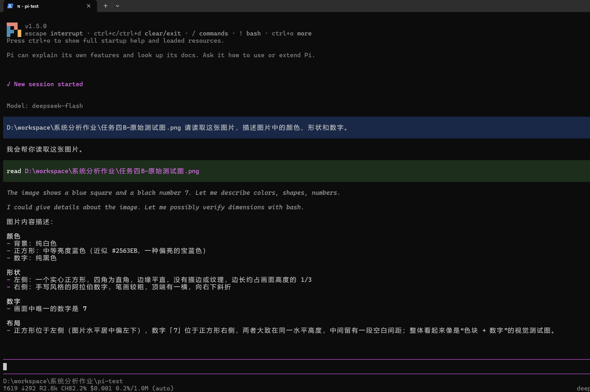

原始测试图

## S6 安装并调用插件

在练习目录运行 `pi.cmd install npm:pi-web-access -l`，将插件安装到当前项目。重启 Pi 后，`[Extensions]` 显示 `pi-web-access:dist`。试用时，首次抓取未取得标题，随后通过 `raw` 模式读取 HTML，得到页面标题 **Example Domain**。

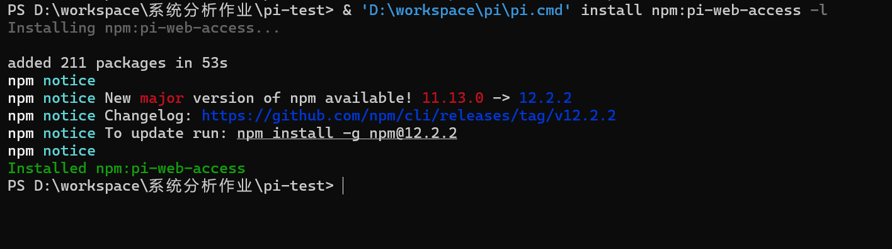

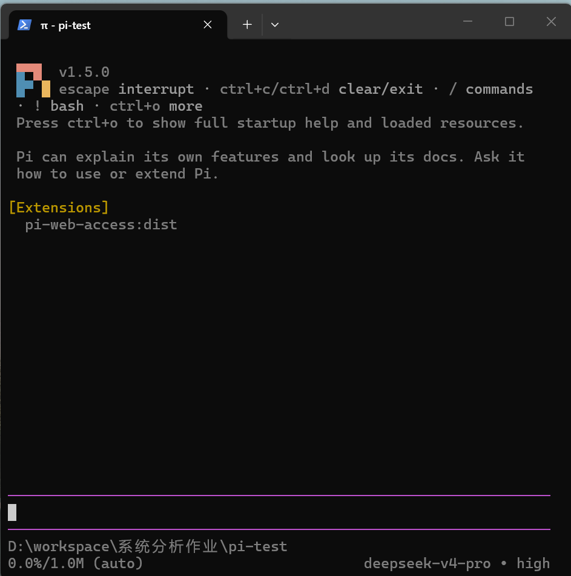

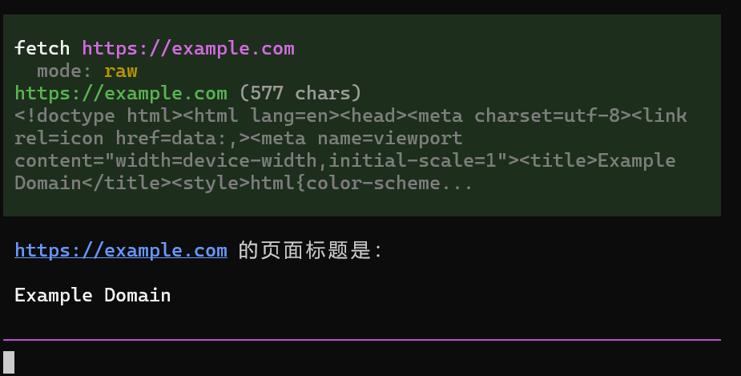

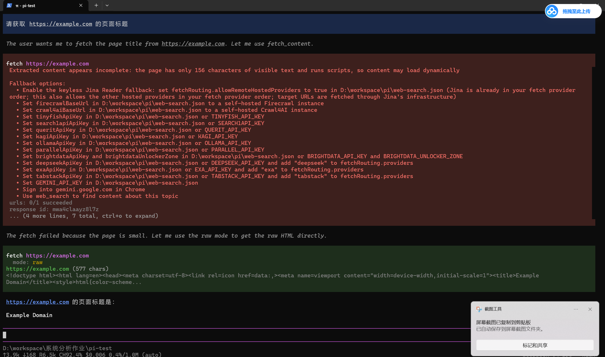

## S7 安装 PPT Skill

从 [Anthropic Skills 仓库](https://github.com/anthropics/skills/tree/2c5958ecac7cee2b583967a2c4981d0f4a75c579/skills/pptx) 获取完整的 `skills/pptx` 目录，安装到 `pi-test/.pi/skills/pptx`。S7 显示目标目录中的 `SKILL.md`、`LICENSE.txt`、`scripts` 和来源记录。

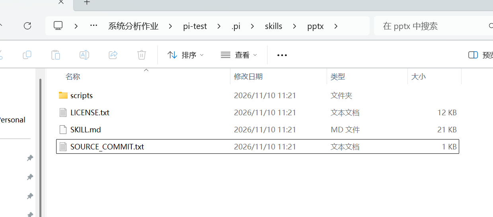

## S8 发现并调用 PPT Skill

从 `pi-test` 重启 Pi，展开启动信息后在 `[Skills]` 下确认 `pptx` 已加载。随后用 `/skill:pptx` 查询名称、用途和加载路径，回复指向本次安装目录中的 `SKILL.md`。使用该 Skill 生成的两页演示文稿已在 WPS 中打开并检查。

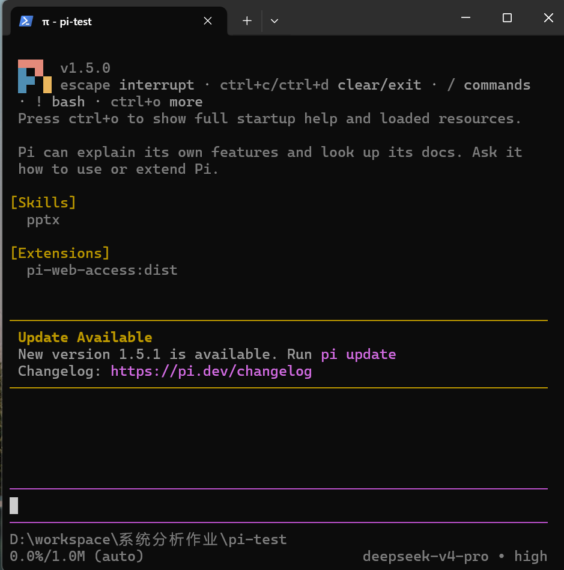

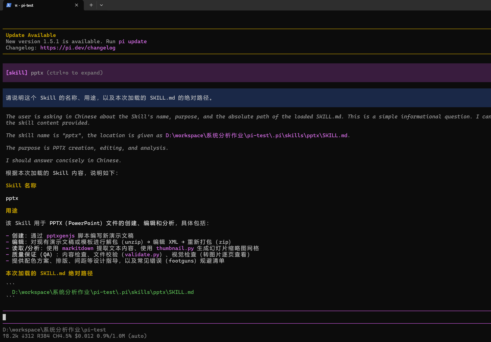

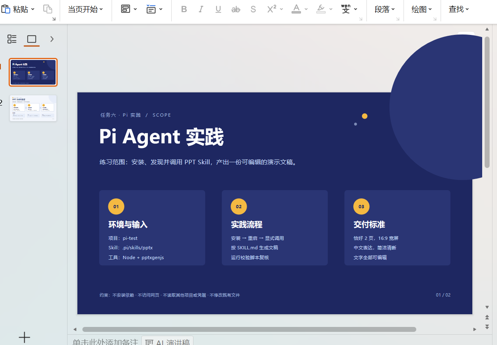

## 选做成果

[两页 PPT 演示文稿](pi-practice.pptx)
