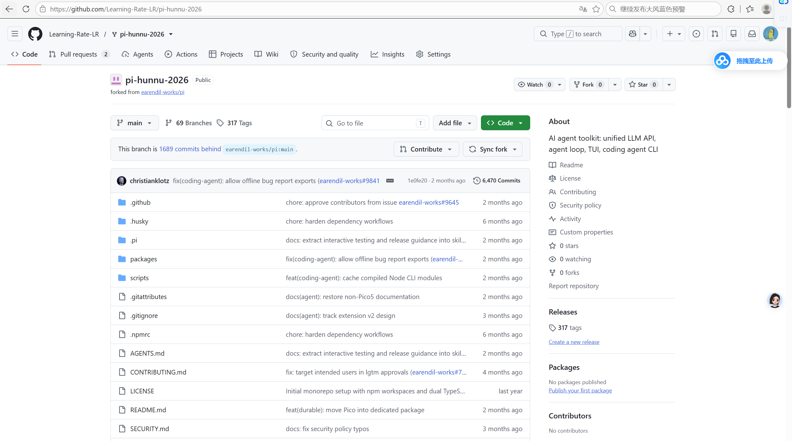
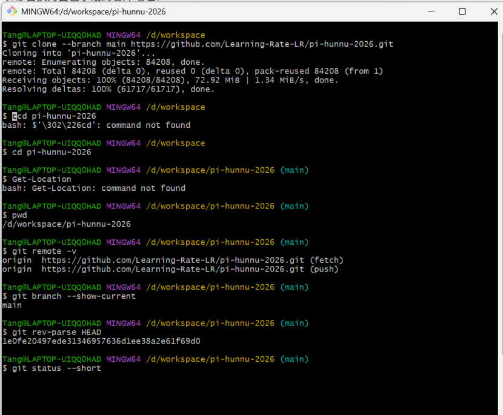
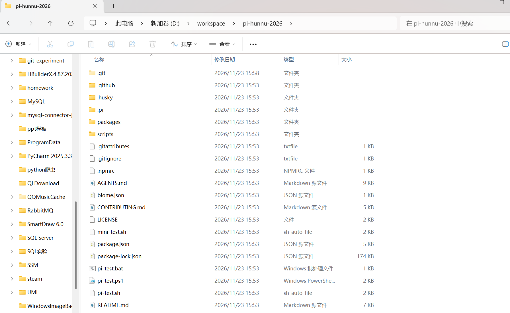
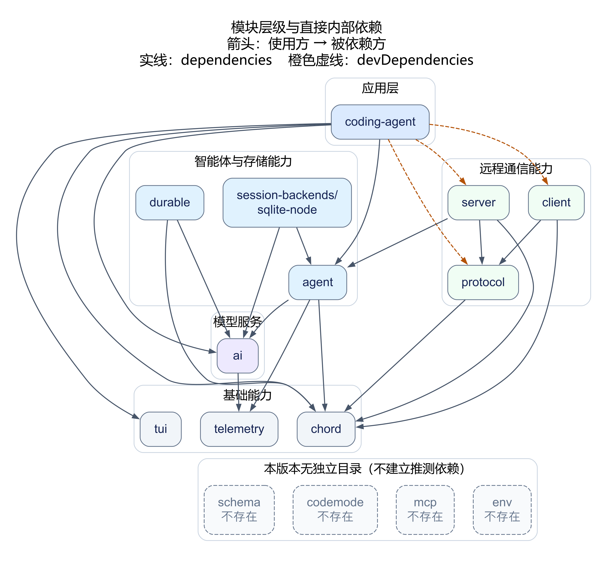

# 实践课2：组织建仓与源码分析

- 姓名拼音：tangjiaqi
- GitHub 登录名：jiaqitang-1
- 小组组织：Learning-Rate-LR
- 小组代码仓库：https://github.com/Learning-Rate-LR/pi-hunnu-2026
- 实际 clone 地址：https://github.com/Learning-Rate-LR/pi-hunnu-2026.git
- 本地源码目录：`D:\workspace\pi-hunnu-2026`
- 分支：`main`
- 完整源码提交编号：`1e0fe20497ede31346957636d1ee38a2e61f69d0`
- 整理日期：2026-11-23
- 重点分析模块：`ai`、`agent`、`coding-agent`

## 1 源码获取与版本确认

### 1.1 小组组织仓库

从小组组织 Learning-Rate-LR 的 pi-hunnu-2026 仓库获取源码。个人仓库用于保存本报告和图片，小组仓库用于团队共同开发。



### 1.2 本地下载和核对

在 Windows Git Bash 中执行：

```bash
cd /d/workspace
git clone --branch main https://github.com/Learning-Rate-LR/pi-hunnu-2026.git
cd pi-hunnu-2026
pwd
git remote -v
git branch --show-current
git rev-parse HEAD
git status --short
```

截图显示源码已克隆到本地；origin 的 fetch/push 地址均指向小组仓库，分支为 main，提交编号如下图。`git status --short` 没有输出，表示核对时工作区没有未提交修改。



Git Bash 不支持 PowerShell 的 Get-Location，因此使用 pwd 查看目录。

### 1.3 源码目录

根目录包含 packages、scripts、package.json、package-lock.json、tsconfig.base.json 等。packages 下实际有 12 个顶层目录，其中 session-backends 是后端包的容器目录。

源码目录截图见本节图片；另提供可检索的[源码目录清单](evidence/source-directory.txt)、[仓库信息记录](evidence/repository-info.txt)。



## 2 版本差异与分析范围

作业示例列出 telemetry、schema、chord、tui、codemode、mcp、ai、durable、env、agent、coding-agent。本次提交的源码不包含独立的 schema、codemode、mcp、env 目录，根 build 也没有调用它们。本报告保留这四项并标注不存在。

实际根构建新增纳入 session-backends/sqlite-node、protocol、client、server，因此补充分析这四个模块。实际目录中的 evals 用于评估相关工作，其 package.json 没有 build 脚本，根 build 未调用它。

依据：[根 package.json](https://github.com/Learning-Rate-LR/pi-hunnu-2026/blob/1e0fe20497ede31346957636d1ee38a2e61f69d0/package.json#L5)、[evals/package.json](https://github.com/Learning-Rate-LR/pi-hunnu-2026/blob/1e0fe20497ede31346957636d1ee38a2e61f69d0/packages/evals/package.json#L1)，以及本地目录清单。

## 3 构建顺序与构建行为

### 3.1 根目录的实际构建顺序

根 [scripts.build](https://github.com/Learning-Rate-LR/pi-hunnu-2026/blob/1e0fe20497ede31346957636d1ee38a2e61f69d0/package.json#L16) 通过 cd 和 npm run build 明确指定以下顺序：

```text
chord → tui → telemetry → ai → durable → agent
→ session-backends/sqlite-node → protocol → client → server → coding-agent
```

这是命令执行顺序，共 11 步，不是依赖箭头。命令用 && 连接，某一步失败时后续步骤不会继续执行。

### 3.2 子模块的公共编译方式

大部分模块的 build 是 `tsgo -p tsconfig.build.json`。各自配置以 src 为输入根目录，输出到本模块 dist，并继承根 [tsconfig.base.json](https://github.com/Learning-Rate-LR/pi-hunnu-2026/blob/1e0fe20497ede31346957636d1ee38a2e61f69d0/tsconfig.base.json#L2)。共享配置启用 declaration、declarationMap 和 sourceMap，因此通常输出 .js、.d.ts 及相应映射文件；具体内容由模块源码和覆盖配置决定。

ai、coding-agent 和 SQLite 会话后端还有生成数据、复制资源或打包步骤，见下表。以下产物说明来自构建脚本和配置分析，本次没有把实际安装依赖或构建运行作为已完成实验，也不声称构建已经成功。

## 4 子模块功能 构建与直接内部依赖

表中“标准编译”使用第 3.2 节的定义。内部依赖是当前仓库各模块 package.json 直接声明的内部包；外部 npm 依赖不在表中展开。无内部依赖不代表没有外部依赖。类型导入和运行时导入在需要时进一步区分，不能仅凭包级声明判断每个调用都会加载哪些实现。

| 子文件夹 | 代码主要实现什么功能 | 本模块 build 执行什么 生成什么 | 直接依赖哪些内部模块 | 依据文件或代码位置 |
| --- | --- | --- | --- | --- |
| `telemetry` | 定义显式传递的 TelemetryContext、Span、事件和类型化 schema；提供空实现、内存参考实现及测试辅助，不绑定具体监控后端。 | 标准编译，输出到本模块 dist。 | 无直接内部运行依赖 | [README](https://github.com/Learning-Rate-LR/pi-hunnu-2026/blob/1e0fe20497ede31346957636d1ee38a2e61f69d0/packages/telemetry/README.md#L1)；[package.json](https://github.com/Learning-Rate-LR/pi-hunnu-2026/blob/1e0fe20497ede31346957636d1ee38a2e61f69d0/packages/telemetry/package.json#L1)；[构建配置](https://github.com/Learning-Rate-LR/pi-hunnu-2026/blob/1e0fe20497ede31346957636d1ee38a2e61f69d0/packages/telemetry/tsconfig.build.json#L1)；[入口源码](https://github.com/Learning-Rate-LR/pi-hunnu-2026/blob/1e0fe20497ede31346957636d1ee38a2e61f69d0/packages/telemetry/src/index.ts#L1) |
| `schema` | 本版本 packages 下无独立目录；不推断其历史功能或替代关系。 | 不适用 | 不适用 | 本地目录截图与目录清单；根 build 未调用该目录。 |
| `chord` | 提供可独立使用的应用组合运行时，包括 facet 插件、服务绑定、远程服务边界、复制状态及 Delta 更新。 | 标准编译，输出到本模块 dist。 | 无直接内部运行依赖 | [README](https://github.com/Learning-Rate-LR/pi-hunnu-2026/blob/1e0fe20497ede31346957636d1ee38a2e61f69d0/packages/chord/README.md#L1)；[package.json](https://github.com/Learning-Rate-LR/pi-hunnu-2026/blob/1e0fe20497ede31346957636d1ee38a2e61f69d0/packages/chord/package.json#L1)；[构建配置](https://github.com/Learning-Rate-LR/pi-hunnu-2026/blob/1e0fe20497ede31346957636d1ee38a2e61f69d0/packages/chord/tsconfig.build.json#L1)；[入口源码](https://github.com/Learning-Rate-LR/pi-hunnu-2026/blob/1e0fe20497ede31346957636d1ee38a2e61f69d0/packages/chord/src/index.ts#L1) |
| `tui` | 提供终端界面框架、输入与键盘处理、组件和差异渲染，使交互式 CLI 只更新变化的画面。 | 标准编译，输出到本模块 dist。 原生平台构建是独立的 build:native:* 脚本，不是普通 build 自动完成。 | 无直接内部运行依赖 | [README](https://github.com/Learning-Rate-LR/pi-hunnu-2026/blob/1e0fe20497ede31346957636d1ee38a2e61f69d0/packages/tui/README.md#L1)；[package.json](https://github.com/Learning-Rate-LR/pi-hunnu-2026/blob/1e0fe20497ede31346957636d1ee38a2e61f69d0/packages/tui/package.json#L1)；[构建配置](https://github.com/Learning-Rate-LR/pi-hunnu-2026/blob/1e0fe20497ede31346957636d1ee38a2e61f69d0/packages/tui/tsconfig.build.json#L1)；[入口源码](https://github.com/Learning-Rate-LR/pi-hunnu-2026/blob/1e0fe20497ede31346957636d1ee38a2e61f69d0/packages/tui/src/index.ts#L1) |
| `codemode` | 本版本 packages 下无独立目录；不推断其历史功能或替代关系。 | 不适用 | 不适用 | 本地目录截图与目录清单；根 build 未调用该目录。 |
| `mcp` | 本版本 packages 下无独立目录；不推断其历史功能或替代关系。 | 不适用 | 不适用 | 本地目录截图与目录清单；根 build 未调用该目录。 |
| `ai` | 统一模型提供方、模型集合、认证、消息和工具调用相关接口，支持流式输出及 token/费用等信息。 | generate-models → build:offline；先生成模型数据，再 check:model-data、标准编译，并将 src/providers/data 复制到 dist/providers/data。 | `telemetry` | [README](https://github.com/Learning-Rate-LR/pi-hunnu-2026/blob/1e0fe20497ede31346957636d1ee38a2e61f69d0/packages/ai/README.md#L1)；[package.json](https://github.com/Learning-Rate-LR/pi-hunnu-2026/blob/1e0fe20497ede31346957636d1ee38a2e61f69d0/packages/ai/package.json#L1)；[构建配置](https://github.com/Learning-Rate-LR/pi-hunnu-2026/blob/1e0fe20497ede31346957636d1ee38a2e61f69d0/packages/ai/tsconfig.build.json#L1)；[入口源码](https://github.com/Learning-Rate-LR/pi-hunnu-2026/blob/1e0fe20497ede31346957636d1ee38a2e61f69d0/packages/ai/src/index.ts#L1) |
| `durable` | 提供对话、任务和文档的记录及存储契约；当前公共入口导出 MemoryStorage 和相关类型，不能据包名推断为 SQLite 实现。 | 标准编译，输出到本模块 dist。 | `chord`、`ai` | [README](https://github.com/Learning-Rate-LR/pi-hunnu-2026/blob/1e0fe20497ede31346957636d1ee38a2e61f69d0/packages/durable/README.md#L1)；[package.json](https://github.com/Learning-Rate-LR/pi-hunnu-2026/blob/1e0fe20497ede31346957636d1ee38a2e61f69d0/packages/durable/package.json#L1)；[构建配置](https://github.com/Learning-Rate-LR/pi-hunnu-2026/blob/1e0fe20497ede31346957636d1ee38a2e61f69d0/packages/durable/tsconfig.build.json#L1)；[入口源码](https://github.com/Learning-Rate-LR/pi-hunnu-2026/blob/1e0fe20497ede31346957636d1ee38a2e61f69d0/packages/durable/src/index.ts#L1) |
| `env` | 本版本 packages 下无独立目录；不推断其历史功能或替代关系。 | 不适用 | 不适用 | 本地目录截图与目录清单；根 build 未调用该目录。 |
| `agent` | 提供有状态智能体、执行循环、工具执行与事件流，并包含 Agent Harness 和会话等能力。 | 标准编译，输出到本模块 dist。 | `chord`、`ai`、`telemetry` | [README](https://github.com/Learning-Rate-LR/pi-hunnu-2026/blob/1e0fe20497ede31346957636d1ee38a2e61f69d0/packages/agent/README.md#L1)；[package.json](https://github.com/Learning-Rate-LR/pi-hunnu-2026/blob/1e0fe20497ede31346957636d1ee38a2e61f69d0/packages/agent/package.json#L1)；[构建配置](https://github.com/Learning-Rate-LR/pi-hunnu-2026/blob/1e0fe20497ede31346957636d1ee38a2e61f69d0/packages/agent/tsconfig.build.json#L1)；[入口源码](https://github.com/Learning-Rate-LR/pi-hunnu-2026/blob/1e0fe20497ede31346957636d1ee38a2e61f69d0/packages/agent/src/index.ts#L1) |
| `coding-agent` | 将智能体、模型和终端界面组合为编程助手 CLI，提供读写/编辑文件、Bash、运行模式和会话管理。 | build:unbundled 先编译、设置 CLI 权限并复制主题/图片/HTML 等资源；再运行根 scripts/build-coding-agent-bundle.mjs，通过 esbuild 输出 dist/bundle。 | `chord`、`agent`、`ai`、`tui`；开发依赖：`client`、`protocol`、`server` | [README](https://github.com/Learning-Rate-LR/pi-hunnu-2026/blob/1e0fe20497ede31346957636d1ee38a2e61f69d0/packages/coding-agent/README.md#L1)；[package.json](https://github.com/Learning-Rate-LR/pi-hunnu-2026/blob/1e0fe20497ede31346957636d1ee38a2e61f69d0/packages/coding-agent/package.json#L1)；[构建配置](https://github.com/Learning-Rate-LR/pi-hunnu-2026/blob/1e0fe20497ede31346957636d1ee38a2e61f69d0/packages/coding-agent/tsconfig.build.json#L1)；[入口源码](https://github.com/Learning-Rate-LR/pi-hunnu-2026/blob/1e0fe20497ede31346957636d1ee38a2e61f69d0/packages/coding-agent/src/index.ts#L1) |
| `session-backends/sqlite-node` | 为 agent 的会话接口提供 SQLite 后端和 Node SQLite 适配，将存储实现与 agent 核心分开。 | 标准编译后执行 scripts/copy-migrations.mjs，将迁移文件复制到 dist/sqlite/migrations。 | `ai`、`agent` | [README](https://github.com/Learning-Rate-LR/pi-hunnu-2026/blob/1e0fe20497ede31346957636d1ee38a2e61f69d0/packages/session-backends/sqlite-node/README.md#L1)；[package.json](https://github.com/Learning-Rate-LR/pi-hunnu-2026/blob/1e0fe20497ede31346957636d1ee38a2e61f69d0/packages/session-backends/sqlite-node/package.json#L1)；[构建配置](https://github.com/Learning-Rate-LR/pi-hunnu-2026/blob/1e0fe20497ede31346957636d1ee38a2e61f69d0/packages/session-backends/sqlite-node/tsconfig.build.json#L1)；[入口源码](https://github.com/Learning-Rate-LR/pi-hunnu-2026/blob/1e0fe20497ede31346957636d1ee38a2e61f69d0/packages/session-backends/sqlite-node/src/index.ts#L1) |
| `protocol` | 定义实验性远程服务协议的路由信封、握手、CBOR 编码及字节流分帧；业务服务语义由 chord 等模块负责。 | 标准编译，输出到本模块 dist。 | `chord` | [README](https://github.com/Learning-Rate-LR/pi-hunnu-2026/blob/1e0fe20497ede31346957636d1ee38a2e61f69d0/packages/protocol/README.md#L1)；[package.json](https://github.com/Learning-Rate-LR/pi-hunnu-2026/blob/1e0fe20497ede31346957636d1ee38a2e61f69d0/packages/protocol/package.json#L1)；[构建配置](https://github.com/Learning-Rate-LR/pi-hunnu-2026/blob/1e0fe20497ede31346957636d1ee38a2e61f69d0/packages/protocol/tsconfig.build.json#L1)；[入口源码](https://github.com/Learning-Rate-LR/pi-hunnu-2026/blob/1e0fe20497ede31346957636d1ee38a2e61f69d0/packages/protocol/src/index.ts#L1) |
| `client` | 提供与传输方式解耦的远程客户端，管理请求、订阅和连接路由，适配 chord 的服务调用与状态更新。 | 标准编译，输出到本模块 dist。 | `chord`、`protocol` | [README](https://github.com/Learning-Rate-LR/pi-hunnu-2026/blob/1e0fe20497ede31346957636d1ee38a2e61f69d0/packages/client/README.md#L1)；[package.json](https://github.com/Learning-Rate-LR/pi-hunnu-2026/blob/1e0fe20497ede31346957636d1ee38a2e61f69d0/packages/client/package.json#L1)；[构建配置](https://github.com/Learning-Rate-LR/pi-hunnu-2026/blob/1e0fe20497ede31346957636d1ee38a2e61f69d0/packages/client/tsconfig.build.json#L1)；[入口源码](https://github.com/Learning-Rate-LR/pi-hunnu-2026/blob/1e0fe20497ede31346957636d1ee38a2e61f69d0/packages/client/src/index.ts#L1) |
| `server` | 提供实验性服务端，处理服务/会话请求路由、连接以及多个呈现端对会话的附着与分离。 | 标准编译，输出到本模块 dist。 | `chord`、`agent`、`protocol` | [README](https://github.com/Learning-Rate-LR/pi-hunnu-2026/blob/1e0fe20497ede31346957636d1ee38a2e61f69d0/packages/server/README.md#L1)；[package.json](https://github.com/Learning-Rate-LR/pi-hunnu-2026/blob/1e0fe20497ede31346957636d1ee38a2e61f69d0/packages/server/package.json#L1)；[构建配置](https://github.com/Learning-Rate-LR/pi-hunnu-2026/blob/1e0fe20497ede31346957636d1ee38a2e61f69d0/packages/server/tsconfig.build.json#L1)；[入口源码](https://github.com/Learning-Rate-LR/pi-hunnu-2026/blob/1e0fe20497ede31346957636d1ee38a2e61f69d0/packages/server/src/index.ts#L1) |

ai 的离线步骤依次为：check:model-data、tsgo 编译、清理并复制 provider 数据。coding-agent 的额外打包依据为 [打包脚本](https://github.com/Learning-Rate-LR/pi-hunnu-2026/blob/1e0fe20497ede31346957636d1ee38a2e61f69d0/scripts/build-coding-agent-bundle.mjs#L14)；SQLite 后端的资源复制依据为 [迁移文件复制脚本](https://github.com/Learning-Rate-LR/pi-hunnu-2026/blob/1e0fe20497ede31346957636d1ee38a2e61f69d0/packages/session-backends/sqlite-node/scripts/copy-migrations.mjs#L1)。

内部包名与目录名的映射及原始 build 字段另存于[配置证据 JSON](evidence/module-manifest.json)。例如 `@earendil-works/pi-agent-core` 对应 agent，不能直接把包名当文件夹名称。

## 5 模块层级与依赖关系图



[可缩放 SVG](diagrams/dependency-graph.svg) · [可编辑 Mermaid 图源](diagrams/dependency-graph.mmd) · [Graphviz 图源](diagrams/dependency-graph.dot)

图中实线表示 dependencies 中声明的直接内部依赖，虚线表示 devDependencies。所有箭头统一为“使用方 → 被依赖方”。四个不存在的目录单独列出，不连接推测的依赖线。图省略外部 npm 包和未参加根 build 的 evals，避免将它们混作本次构建模块。

按职责分为应用层、智能体与存储能力、远程通信能力、模型服务和基础能力。chord 提供应用组合机制，tui 提供终端界面，telemetry 提供追踪契约；ai 提供模型服务；agent、durable 和 SQLite 后端负责智能体或记录/存储能力；protocol、client、server 负责远程通信；coding-agent 组合能力形成用户使用的 CLI。该职责划分允许跨层依赖。

coding-agent 对 client、protocol、server 的三条边是开发依赖；不能将它们与 dependencies 中的四条边画成同一种关系。依赖图展示包声明关系，不把间接依赖补画成直接依赖。

## 6 三个问题的回答

### 6.1 根目录与子模块中的 npm run build 分别读取什么配置 执行什么工作

在根目录运行 npm run build，npm 读取根 package.json 的 scripts.build。根脚本负责切换目录和安排调用顺序，不是直接编译全部源码的单一编译命令。

进入子模块后，同名 npm 命令读取该模块自己的 package.json。多数模块调用 tsgo 并通过 -p 明确读取 tsconfig.build.json；编译器再读取该文件继承的根 tsconfig.base.json。一些模块还会执行生成模型数据、复制资源、打包等命令。

根 [tsconfig.json](https://github.com/Learning-Rate-LR/pi-hunnu-2026/blob/1e0fe20497ede31346957636d1ee38a2e61f69d0/tsconfig.json#L4) 设置 noEmit: true，配置整体源码检查及内部包路径；不能因为它在根目录，就说根 build 必然用它输出全部模块。agent、durable 等构建配置明确指向其他包已生成的 dist 类型声明，是构建依赖顺序的重要证据。

### 6.2 构建顺序和依赖的关系 相邻构建的模块是否一定互相依赖

当使用方的编译要解析被依赖方生成的 JavaScript 或类型声明时，通常应先构建被依赖方，再构建使用方。例如 [agent 构建配置](https://github.com/Learning-Rate-LR/pi-hunnu-2026/blob/1e0fe20497ede31346957636d1ee38a2e61f69d0/packages/agent/tsconfig.build.json#L5) 将 chord、telemetry、ai 映射到各自 dist 中的声明文件，因此根脚本先构建这三个包。

相邻构建不表示存在依赖。例如根脚本先构建 chord，随后构建 tui，但 tui 的 package.json 没有声明 chord 为内部依赖。根脚本给出一种满足项目要求的执行安排，不能把顺序链机械转换为依赖链；它也没有自动计算依赖拓扑。

另一个例子是 durable 在 agent 前构建，但 agent 的直接内部依赖没有 durable。这再次说明分析必须分别查看构建脚本、依赖声明和编译配置。

### 6.3 至少三个模块的依赖路径及分工

选择路径：

```text
coding-agent → agent → ai → telemetry
```

coding-agent 提供 CLI、文件/Bash 工具、会话和模式管理。其 [AgentSession](https://github.com/Learning-Rate-LR/pi-hunnu-2026/blob/1e0fe20497ede31346957636d1ee38a2e61f69d0/packages/coding-agent/src/core/agent-session.ts#L2) 封装会话生命周期、状态访问、事件订阅、模型切换与压缩等工作，并导入 agent 和 ai 提供的类型与能力。

agent 负责智能体循环与工具执行。[agent-loop.ts](https://github.com/Learning-Rate-LR/pi-hunnu-2026/blob/1e0fe20497ede31346957636d1ee38a2e61f69d0/packages/agent/src/agent-loop.ts#L37) 接收消息和上下文，组织运行并输出事件流；源码从 pi-ai 导入消息/事件类型、工具声明转换和参数验证等能力。它把编程助手中的通用执行机制提取成可复用模块。

ai 负责统一模型与提供方接口、认证和消息流等，让上层不必在每处分别处理不同模型厂商的数据结构。[ai 公共入口](https://github.com/Learning-Rate-LR/pi-hunnu-2026/blob/1e0fe20497ede31346957636d1ee38a2e61f69d0/packages/ai/src/index.ts#L1) 展示模型、认证、类型和事件流等导出；其包配置声明直接依赖 telemetry。

telemetry 提供可显式传递的上下文、Span、事件和状态契约，供模型调用等操作记录运行信息。它不直接承担模型推理或 CLI 展示。

以“让编程助手读取一个文件并解释内容”为例：coding-agent 提供输入与文件工具，agent 组织模型请求和工具调用循环，ai 对接模型与消息事件，telemetry 为相关操作提供追踪结构。这是模块职责的解释；上面的箭头表示包级直接依赖，不保证每个操作都严格按四个模块同步串行调用。

## 7 重点分析说明

重点分析 ai、agent、coding-agent，原因是它们覆盖“模型接口—通用执行循环—面向用户的编程工具”这一条主要路径。与仅阅读包简介相比，AgentSession 的职责注释、agentLoop 的输入/事件流和入口导出能进一步说明这些模块如何分工。


## 8 附件与参考

- [作业要求](https://github.com/hunnuOpenSourceSoftware2026/assignments/blob/main/practice/02-Pi-Agent-fork.md)
- [固定源码版本](https://github.com/Learning-Rate-LR/pi-hunnu-2026/tree/1e0fe20497ede31346957636d1ee38a2e61f69d0)
- [依赖图 PNG](diagrams/dependency-graph.png)、[SVG](diagrams/dependency-graph.svg)、[Mermaid 图源](diagrams/dependency-graph.mmd)
- [源码目录清单](evidence/source-directory.txt)、[仓库信息](evidence/repository-info.txt)、[模块配置证据](evidence/module-manifest.json)
