# 实践课3：Pi Agent 源码安装与编译

- 姓名拼音：tangjiaqi
- GitHub 登录名：jiaqitang-1
- 实验日期：2026-11-26
- 小组代码仓库：https://github.com/Learning-Rate-LR/pi-hunnu-2026
- 实际 clone 地址：https://github.com/Learning-Rate-LR/pi-hunnu-2026.git
- 本地源码目录：`D:\workspace\pi-hunnu-2026`
- 基础分支：`main`
- 基础提交：`1e0fe20497ede31346957636d1ee38a2e61f69d0`
- 运行版本：`0.86.1`
- 最终源码状态：基础提交加本地 opencode-go 兼容补丁；补丁及修复文件随报告附上，尚未提交到小组仓库。

## 实验目标与结果

本次在 Windows PowerShell 中安装小组仓库依赖、生成模型目录、编译全部构建模块，并分别验证编译入口和源码入口，最后在源码版 Pi 中完成实际模型对话。

| 检查项 | 实际结果 | 证据 |
| --- | --- | --- |
| 开发工具 | Node.js v24.16.0、npm 11.13.0、Git 2.55.0.windows.2 | S1 |
| 依赖安装 | 退出码 0，node_modules、tsgo、tsx 均存在 | S4 |
| 在线模型目录生成 | strict 模式下下载与生成成功；随后遇到源码类型错误 | 在线构建日志与困难记录 |
| 最终完整构建 | 修复后执行根 build:offline，退出码 0，生成 56 个打包文件 | 完整构建日志 |
| 编译入口 | 文件存在，版本 0.86.1，版本命令退出码 0 | S5、verification.json |
| 源码入口 | pi-test.bat --version 输出 0.86.1，退出码 0 | S6、verification.json |
| 实际会话 | 收到 DeepSeek 回复；另有单次调用退出码 0 | S6、会话日志 |

构建、启动、模型调用与完整开发检查是不同的验证结果；本次不把构建成功写成全部测试或检查通过。

## 任务一 实验准备 检查开发工具

执行 `node --version`、`npm.cmd --version`、`git --version`，得到上表版本。Node.js 的最低要求由根 package.json 的 engines.node 声明为 >=22.19.0，本机使用 24 系列。

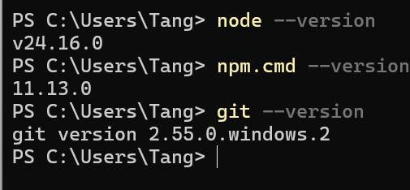

Node.js 运行 JavaScript 和开发脚本，npm 管理项目依赖并执行脚本，Git 获取并管理源码。使用 Node.js 随附的 npm，没有根据升级提示改装 npm 12。

## 任务二 下载源码并确认来源和版本

沿用实践课 2 已克隆的小组仓库，不重复下载。安装前在仓库根目录检查当前目录、origin、分支、完整提交编号和工作区状态：

```powershell
Set-Location D:\workspace\pi-hunnu-2026
Get-Location
git remote -v
git branch --show-current
git rev-parse HEAD
git status --short
```

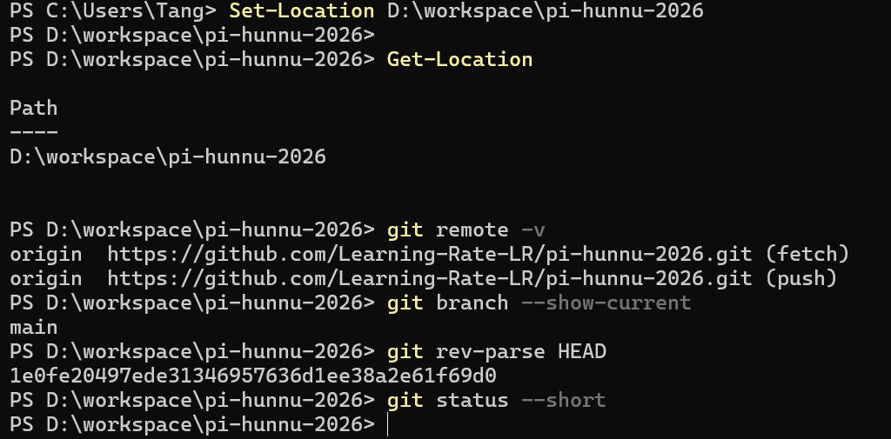

该图记录安装和修复前的干净工作区。最终为解决编译错误修改了一个源文件，因此实际运行状态不能只用基础提交编号表示；[本地补丁](patches/opencode-go-google-api.patch)记录了差异。

## 任务三 阅读配置 确认安装与编译依据

阅读依据：[根 README](https://github.com/Learning-Rate-LR/pi-hunnu-2026/blob/1e0fe20497ede31346957636d1ee38a2e61f69d0/README.md)、[根 package.json](https://github.com/Learning-Rate-LR/pi-hunnu-2026/blob/1e0fe20497ede31346957636d1ee38a2e61f69d0/package.json)、[package-lock.json](https://github.com/Learning-Rate-LR/pi-hunnu-2026/blob/1e0fe20497ede31346957636d1ee38a2e61f69d0/package-lock.json)、[CLI package.json](https://github.com/Learning-Rate-LR/pi-hunnu-2026/blob/1e0fe20497ede31346957636d1ee38a2e61f69d0/packages/coding-agent/package.json)。

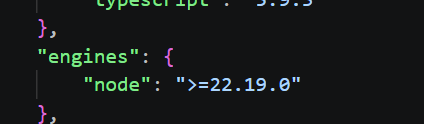

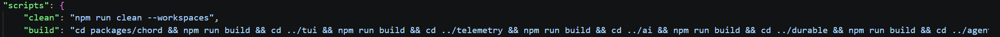

截图展示 build 的前半段，完整脚本见上述源码链接。实际根构建顺序为：

```text
chord → tui → telemetry → ai → durable → agent
→ session-backends/sqlite-node → protocol → client → server → coding-agent
```

根 package.json 中的 workspaces 将同一仓库的多个包组织起来；devDependencies 提供编译器、打包器等开发工具；package-lock.json 锁定依赖版本和关系。安装从根目录进行，没有给每个模块另建锁文件。

npm run build 从当前包 package.json 的 scripts.build 读取命令。根脚本安排构建顺序；各子包读取自己的脚本，通常运行 tsgo -p tsconfig.build.json，部分子包还生成模型数据、复制资源或打包。&& 表示前一步成功才继续下一步。CLI 的 bin.pi 指向 dist/bundle/cli.js。

问题回答：Node.js 最低版本要求来自根 package.json 的 engines.node。npm run build 读取当前包 package.json 中 scripts.build 的命令。根脚本安排各子包的构建顺序，子包脚本执行各自的编译或其他处理。package-lock.json 用于锁定依赖版本和关系。

## 任务四 安装项目依赖

在源码根目录执行：

```powershell
npm install --ignore-scripts
```

该命令根据 package.json 与锁文件安装当前项目依赖并关联本地 workspace，建立 node_modules，提供 tsgo、tsx 等开发工具。--ignore-scripts 跳过安装时自动触发的 postinstall、prepare 等生命周期脚本，后续仍可主动执行 npm run build。没有使用 -g，因此不会把这份源码自动安装为全局 pi。

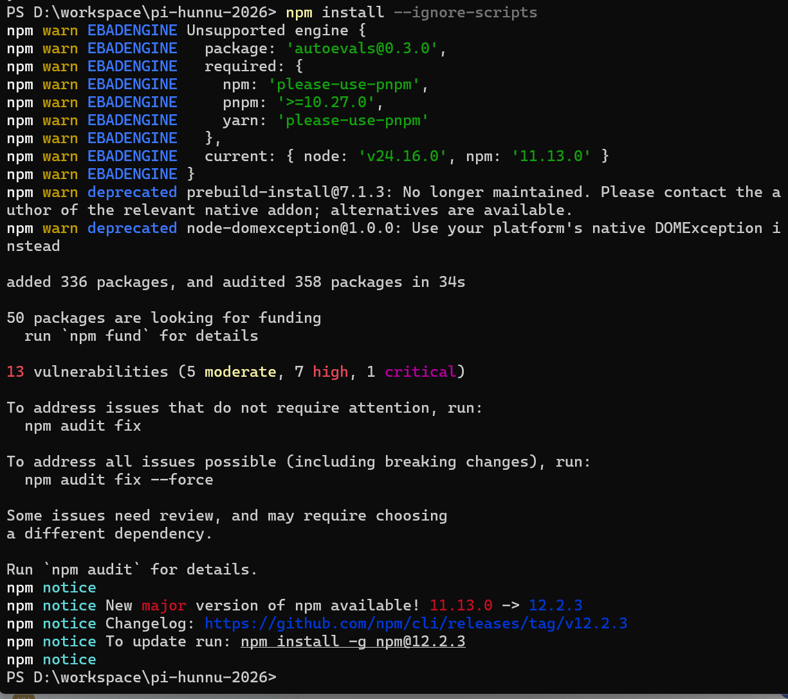

本次输出 added 336 packages、audited 358 packages。随后检查退出码和工具文件：

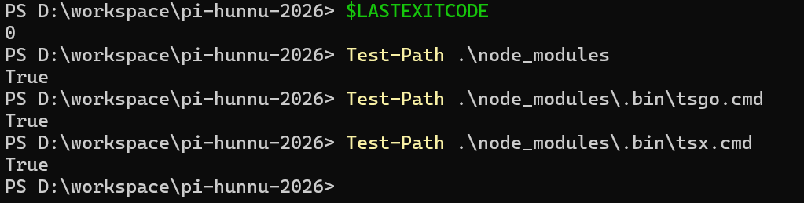

### 安装警告分析

- autoevals@0.3.0 的 EBADENGINE 指向其 npm/pnpm/yarn 要求，其中 npm 为 please-use-pnpm；不是本次 Node.js 24 未满足根 engines 的证明。安装最终退出码为 0，实验继续按课程 npm workspaces 流程操作。
- prebuild-install@7.1.3 与 node-domexception@1.0.0 的 deprecated 是弃用提示，本次没有因此终止安装。
- 审计输出 13 个漏洞：5 moderate、7 high、1 critical。这是该次安装依赖树的审计结果，不能写成“没有安全问题”。本次未执行 npm audit fix --force，避免改变依赖版本；漏洞处理仍需另行评估。
- 50 packages are looking for funding 和 npm 新版本通知不代表安装失败。

## 任务五 本地编译与构建产物验证

### 在线模型目录生成

首次运行 npm run build 时，ai 的 generate-models --strict 因访问 models.dev 或 radius.pi.dev 超时而中断。配置代理并增加连接超时与重试后，在线日志显示 models.dev、NVIDIA、OpenRouter、Vercel AI Gateway、Radius 数据均已获取，生成 1662 个支持工具调用的模型记录。

模型目录是模型名称、接口、能力等元数据，不是大模型权重。源码 [generate-models.ts](https://github.com/Learning-Rate-LR/pi-hunnu-2026/blob/1e0fe20497ede31346957636d1ee38a2e61f69d0/packages/ai/scripts/generate-models.ts) 说明在线数据生成过程；[在线生成与类型报错日志](logs/01-online-generation-and-type-error.log)保留成功生成以及随后编译失败的实际输出。

### 修复后完成全部构建

在线数据已生成且 check:model-data 校验成功，修复 opencode-go 类型与接口实现后运行：

```powershell
npm.cmd run build:offline
```

该命令仍按根脚本重建所有相关模块，只在 ai 阶段复用已校验的模型目录。不是在没有数据时跳过首次数据准备，也没有取消 strict 模式或删除模型。

完整输出末尾为：

```text
Built packages\coding-agent\dist\bundle (56 files, 8.3 MiB)
BUILD_EXIT_CODE=0
```

[完整成功构建日志](logs/02-successful-offline-build.log) · [构建与入口核验记录](evidence/build-verification.txt)

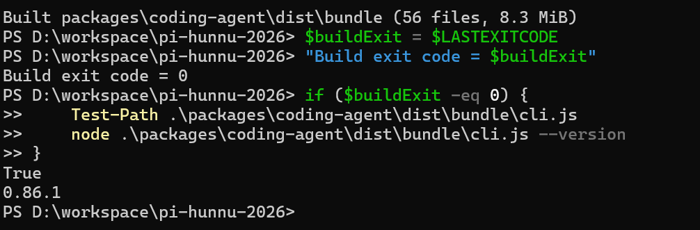

图中显示实际终端的构建末尾输出，随后读取 $LASTEXITCODE 得到 0，并检查入口文件存在、通过本地路径输出版本 0.86.1。

### 检查并运行编译入口

```powershell
Test-Path .\packages\coding-agent\dist\bundle\cli.js
node .\packages\coding-agent\dist\bundle\cli.js --version
```

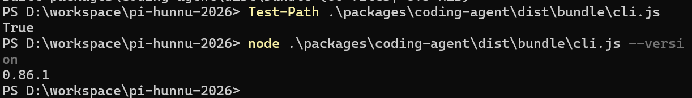

文件存在，版本为 0.86.1；补充核验的版本命令退出码为 0。核验数据及入口 SHA-256 保存在 [verification.json](evidence/verification.json)。修改功能时应修改 src 并重新构建，直接修改 dist 会在后续构建时被覆盖。

## 任务六 启动本地源码版本并完成一次会话

### 验证源码入口

在源码根目录执行：

```powershell
.\pi-test.bat --version
.\pi-test.bat
```

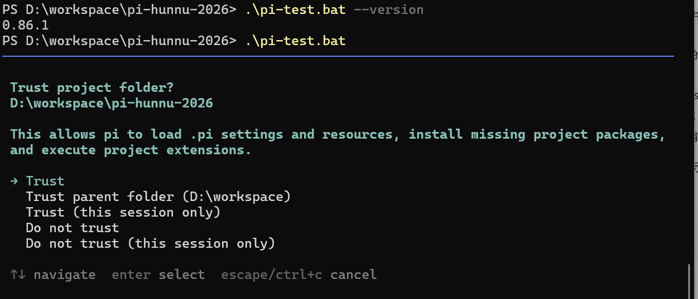

输出 0.86.1。Trust project folder 是启动时的信任询问，不是编译错误；为了基础验证，可以仅本次忽略项目 .pi 扩展资源，不需要永久信任父目录。

### 实际模型会话

输入：

```text
请用一句话说明源码和编译产物的区别。只回答问题，不修改文件。
```

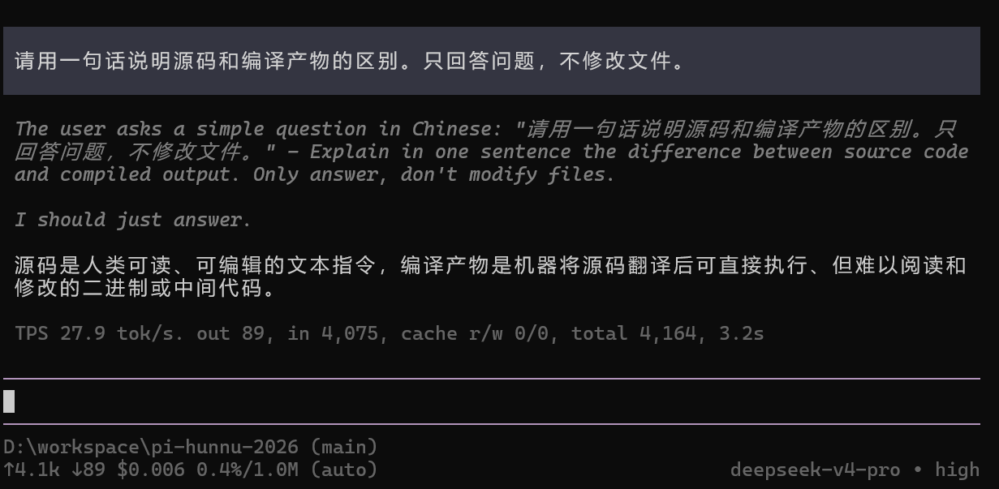

图中同时显示仓库路径、pi-test.bat 启动命令、pi v0.86.1、测试问题和实际回复，模型为 deepseek-flash、thinking off。回复指出源码是开发者编写的原始文本（如 .ts），编译产物是工具转换或打包后生成的文件（如 .js）。另一次单次调用的退出码为 0，见[会话输出日志](logs/04-source-conversation.log)。

### 如何确认运行的是本地源码

运行命令使用仓库内的 pi-test.bat；该文件调用 pi-test.ps1，再通过本地 tsx 运行 packages/coding-agent/src/cli.ts。没有用一个来源不明的全局 pi 命令代替本地入口。

本机已有登录配置实际保存在 D:\workspace\pi，辅助启动时通过 PI_CODING_AGENT_DIR 指向该目录复用登录。复用配置只决定认证与偏好来源，不改变当前运行的源码入口。没有把 auth.json、API Key 或令牌上传到报告仓库。

辅助启动命令中的 --offline 仅跳过启动阶段联网刷新，不会阻止模型请求；--no-approve 仅本次忽略项目 .pi 扩展资源，没有永久修改目录信任设置。

### 两种入口适用场景

| 入口 | 本次使用方式 | 适用场景 |
| --- | --- | --- |
| pi-test.bat → src/cli.ts | 验证源码版本并进行交互会话 | 开发与调试源码 |
| node packages/coding-agent/dist/bundle/cli.js | 验证构建产物存在且能输出版本 | 检查编译和打包结果能否运行 |

源码入口依据：[pi-test.bat](https://github.com/Learning-Rate-LR/pi-hunnu-2026/blob/1e0fe20497ede31346957636d1ee38a2e61f69d0/pi-test.bat)、[pi-test.ps1](https://github.com/Learning-Rate-LR/pi-hunnu-2026/blob/1e0fe20497ede31346957636d1ee38a2e61f69d0/pi-test.ps1)。构建入口依据：[CLI package.json](https://github.com/Learning-Rate-LR/pi-hunnu-2026/blob/1e0fe20497ede31346957636d1ee38a2e61f69d0/packages/coding-agent/package.json)。

## 遇到的困难与解决过程

### 模型目录下载超时及连接断开

最初错误包括 UND_ERR_CONNECT_TIMEOUT 和 ECONNRESET。一次 models.dev 测试返回 200，只能说明该次请求成功；完整生成还会访问其他数据源，因此后续 Radius 仍可能失败。

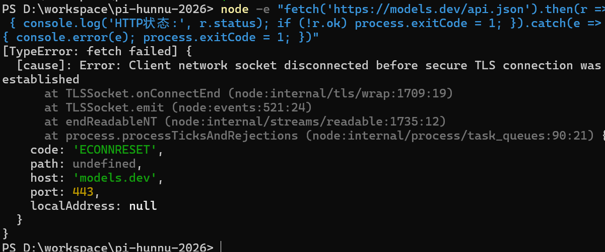

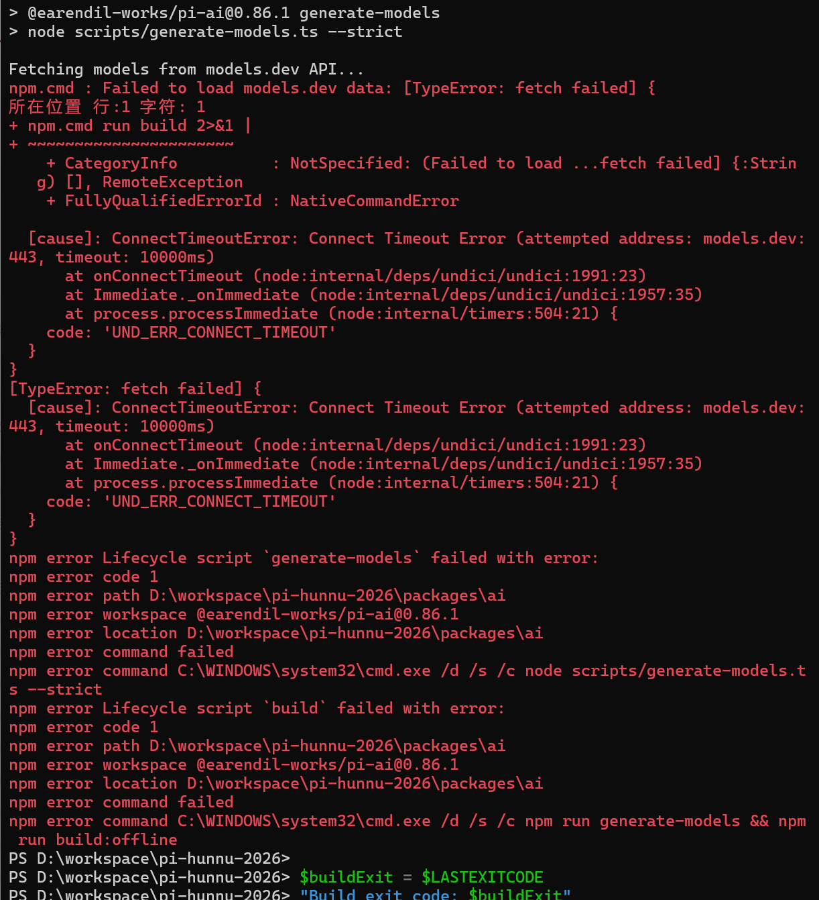

先设置当前进程的 HTTP_PROXY、HTTPS_PROXY、NODE_USE_ENV_PROXY，使用已有的 127.0.0.1:7897 代理。仍不稳定时，使用[临时网络辅助脚本](scripts/pi-build-network.cjs)，对模型生成进程显式指定 ProxyAgent，连接超时设为 60 秒，对 GET/HEAD 最多重试两次。没有关闭 TLS 证书校验，没有改依赖版本。该脚本只作用于模型目录生成或探测进程。

### NODE_OPTIONS 中的 Windows 路径转义

曾使用反斜杠路径预加载辅助脚本，实际报错路径变成 D:workspace系统分析作业qapi-build-network.cjs，导致 MODULE_NOT_FOUND，构建尚未开始。改成正斜杠路径，并先检查 Node 与其子进程能够加载预加载文件后再执行构建。

示例设置为当前进程变量，不是永久修改系统配置：

```powershell
$env:NODE_OPTIONS = '--require=D:/workspace/系统分析作业/qa/pi-build-network.cjs'
npm.cmd run build
```

报告附件中的脚本是该辅助文件的归档副本；换电脑使用时需要修改其中源码仓库位置和代理端口。

### 最新模型目录与旧源码接口类型不一致

网络阶段通过后，编译出现 TS2322：opencode-go 的新模型列表包含 google-generative-ai，而该提供方只声明并注册 anthropic-messages、openai-completions、openai-responses。

参照同目录已有 opencode 提供方，为 opencode-go 导入 googleGenerativeAIApi，扩展 Provider 的接口类型，并注册 Google API 适配。这同时补齐类型和实际运行实现，没有简单扩大类型后忽略实际适配，也没有通过删除模型规避错误。

[修复补丁](patches/opencode-go-google-api.patch) · [最终修复文件](patches/opencode-go.fixed.ts) · [参照的 opencode 实现](https://github.com/Learning-Rate-LR/pi-hunnu-2026/blob/1e0fe20497ede31346957636d1ee38a2e61f69d0/packages/ai/src/providers/opencode.ts)

### 完整开发检查仍存在的限制

修复后额外执行 npm run check：格式化、依赖声明、相对导入、入口图、shrinkwrap 和 install-lock 检查已通过；整体 tsgo --noEmit 在测试代码处报错，例如测试仍引用 devstral-medium-latest、mimo-v2.5-pro 等当前目录已不包含的模型。检查退出码为 2，后续 browser-smoke 未执行。

因此本报告仅确认全部构建、源码/产物版本验证和实际对话通过，不声称全量开发检查或全部测试通过。没有为完成本次构建而批量改动测试。

[完整开发检查输出](logs/03-development-check-failed.log)

## 附件与协助说明

环境检查、安装及最终交互截图来自本次实际操作；网络诊断、源码兼容修复、构建和材料整理使用了 AI 辅助。修复以源码与实际命令输出验证，保留未通过的检查结果和完整日志。

- [作业要求](https://github.com/hunnuOpenSourceSoftware2026/assignments/blob/main/practice/03-Pi-Agent-source-build.md)
- [成功构建日志](logs/02-successful-offline-build.log)
- [构建与入口验证](evidence/build-verification.txt)、[结构化核验](evidence/verification.json)
- [模型目录清单及校验信息](evidence/model-data-manifest.json)
- [源码兼容补丁](patches/opencode-go-google-api.patch)、[临时网络脚本](scripts/pi-build-network.cjs)
