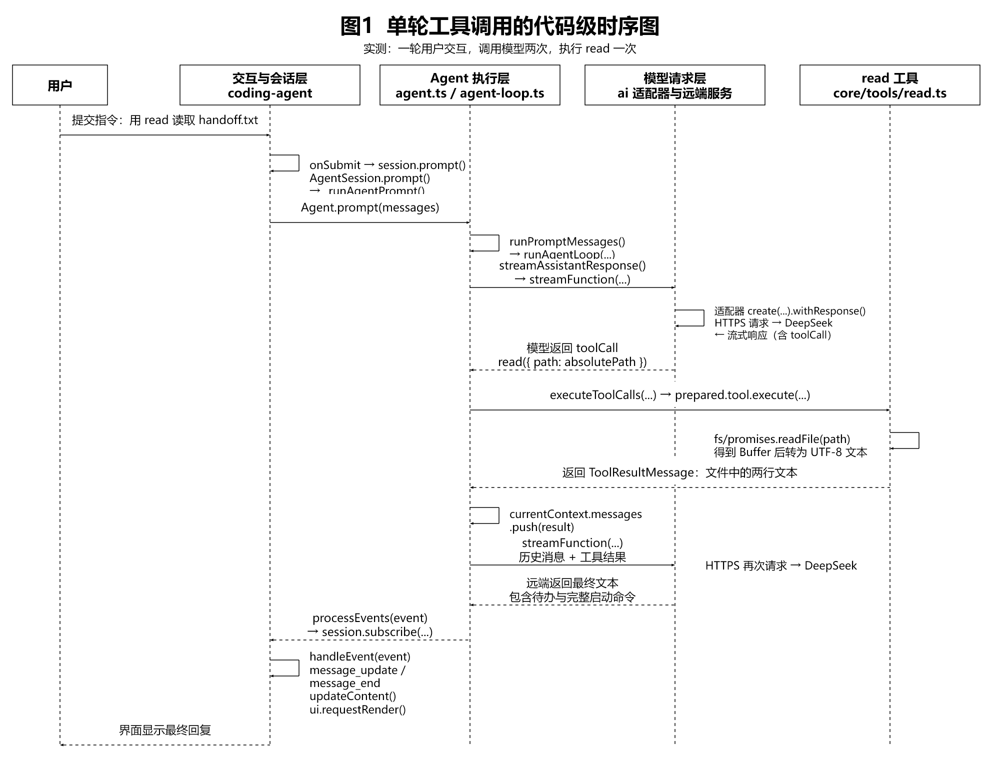
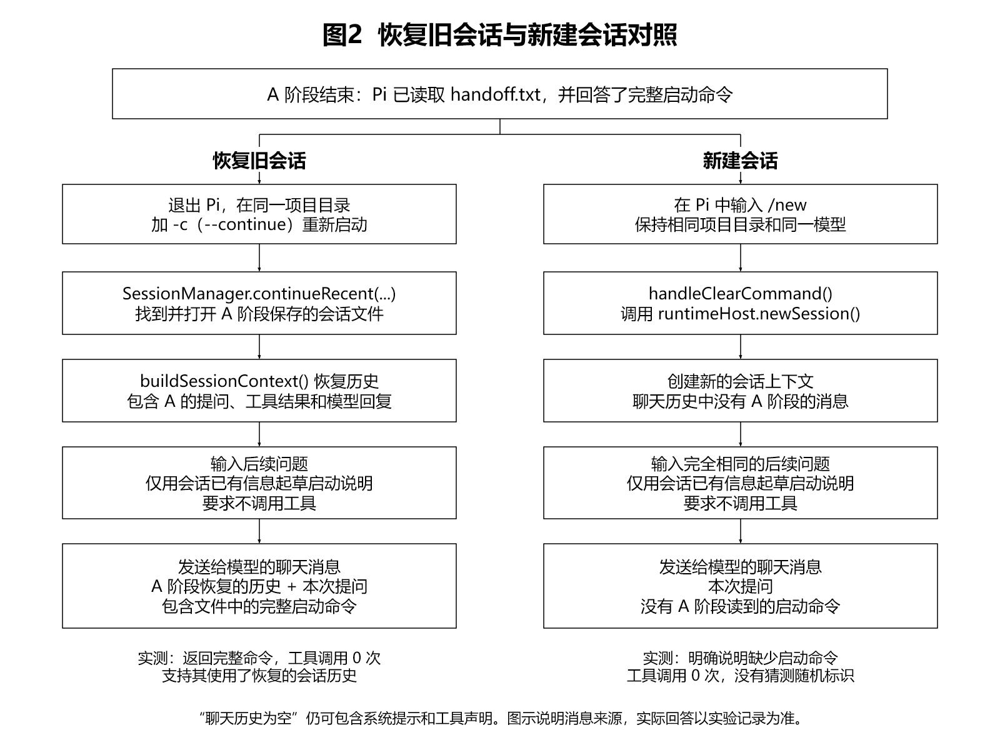

# 实践课5：Pi Agent 工具调用与会话恢复

- 姓名拼音：tangjiaqi
- GitHub：jiaqitang-1
- 小组源码仓库：[Learning-Rate-LR/pi-hunnu-2026](https://github.com/Learning-Rate-LR/pi-hunnu-2026)
- 实验日期：2026-11-26
- 本地工作目录：`D:\workspace\pi-hunnu-2026`
- Pi：`0.86.1`，模型：`deepseek / deepseek-flash`，thinking：`off`
- 源码基准：`1e0fe20497ede31346957636d1ee38a2e61f69d0`。本地保留实践4在 `agent-loop.ts` 中增加的两条日志，不改变本文分析的调用关系。
- 任务依据：[实践05说明](https://github.com/hunnuOpenSourceSoftware2026/assignments/blob/main/practice/05-Pi-Agent-source-reading.md)。本文重点定位输入提交、Agent 循环、read 实现和会话恢复入口。

## A. 一次交互中的工具调用

交接文件 [handoff.txt](practice-05/evidence/handoff.txt) 包含：

```text
待办：补充 README 的启动说明
启动命令：npm run demo -- --profile lr-5800f710
```

这里的命令只是本实验的随机标识载体，并未把它当成 Pi 或此仓库真实的启动命令执行。

在本地构建版 Pi 的新会话中输入以下问题，提问没有透露命令：

> 请用 read 工具读取当前目录的 handoff.txt，原样告诉我待办和启动命令。

实际记录中，模型先回复 `I'll read that file.`，接着发出一次 `read` 调用，参数 `path` 为 `D:/workspace/pi-hunnu-2026/handoff.txt`，`offset`、`limit` 均为 `null`。工具返回交接单两行文本后，模型再次生成回复，给出原始待办与完整命令 `npm run demo -- --profile lr-5800f710`，并指出文件开头有 BOM。

因此，这是一轮用户交互，包含两次模型调用和一次 read 执行。第一次模型输出工具调用，工具结果加入上下文后，第二次模型调用给出最终文本。模型不会因为知道工具名称就直接读取本机文件，文件访问由本地工具执行。

### 图1：单轮工具调用的代码级时序图



[下载可编辑 PPT 图源](practice-05/figures/figure-1.pptx)

图中 `absolutePath` 对应上文的完整文件路径。五条生命线按职责合并了同一层的对象，自调用表示同层调用。实线表示调用，虚线表示返回或事件。为便于阅读，底部合并展示 UI 回复显示路径；实际 `message_update` 可以在模型流式返回期间多次触发，并非必须等最终回复完成才显示。

### 源码定位与分工

以下链接固定到本次源码基准。`agent-loop.ts` 的本地日志会使后续行号略有偏移，定位时以函数和语句为准。

| 位置 | 关键函数或语句 | 本次交互中的作用 |
| --- | --- | --- |
| [interactive-mode.ts](https://github.com/Learning-Rate-LR/pi-hunnu-2026/blob/1e0fe20497ede31346957636d1ee38a2e61f69d0/packages/coding-agent/src/modes/interactive/interactive-mode.ts#L3077) | 编辑器 `onSubmit`、`this.session.prompt(text)` | 接受用户文本并交给会话层 |
| [agent-session.ts](https://github.com/Learning-Rate-LR/pi-hunnu-2026/blob/1e0fe20497ede31346957636d1ee38a2e61f69d0/packages/coding-agent/src/core/agent-session.ts) | `AgentSession.prompt()`、`_runAgentPrompt()`、`this.agent.prompt(messages)` | 处理会话输入，调用 Agent |
| [agent.ts](https://github.com/Learning-Rate-LR/pi-hunnu-2026/blob/1e0fe20497ede31346957636d1ee38a2e61f69d0/packages/agent/src/agent.ts#L366) | `Agent.prompt()`、`runPromptMessages()`、`runAgentLoop()` | 规范化输入，启动执行循环 |
| [agent-loop.ts](https://github.com/Learning-Rate-LR/pi-hunnu-2026/blob/1e0fe20497ede31346957636d1ee38a2e61f69d0/packages/agent/src/agent-loop.ts) | `streamAssistantResponse()`、`streamFunction(...)`、`executeToolCalls()`、`prepared.tool.execute(...)`、`currentContext.messages.push(result)` | 请求模型，执行工具，将结果加入上下文后再次请求模型 |
| [deepseek.ts](https://github.com/Learning-Rate-LR/pi-hunnu-2026/blob/1e0fe20497ede31346957636d1ee38a2e61f69d0/packages/ai/src/providers/deepseek.ts) / [openai-completions.ts](https://github.com/Learning-Rate-LR/pi-hunnu-2026/blob/1e0fe20497ede31346957636d1ee38a2e61f69d0/packages/ai/src/api/openai-completions.ts#L371) | DeepSeek 适配器、`client.chat.completions.create(params, requestOptions).withResponse()` | 把消息和工具声明交给远端模型，并处理流式响应 |
| [read.ts](https://github.com/Learning-Rate-LR/pi-hunnu-2026/blob/1e0fe20497ede31346957636d1ee38a2e61f69d0/packages/coding-agent/src/core/tools/read.ts#L4) | `fs/promises` 的 `readFile` 别名 `fsReadFile`，`buffer.toString("utf-8")` | 默认操作读取 Buffer，再解码为文本；本次文本文件读取不是 `createReadStream` |
| [interactive-mode.ts](https://github.com/Learning-Rate-LR/pi-hunnu-2026/blob/1e0fe20497ede31346957636d1ee38a2e61f69d0/packages/coding-agent/src/modes/interactive/interactive-mode.ts#L3278) | `session.subscribe(...)`、`handleEvent()` 的 `message_update` / `message_end` 分支、`updateContent()`、`ui.requestRender()` | 订阅会话事件，更新回复组件并请求终端重绘 |

若要修改输入提交行为，应先查看 `onSubmit`；要改变工具结果如何驱动后续模型调用，应查看 Agent 循环；要修改文件读取与文本截断，应查看 read 工具；要修改显示方式，应查看交互界面的事件分支。

## B. 恢复旧会话与新建会话

A 会话结束后退出 Pi，在同一源码仓库目录重新启动本地编译入口，并添加 `-c`：

```powershell
cd D:\workspace\pi-hunnu-2026
$env:PI_CODING_AGENT_DIR = 'D:\workspace\pi'
node .\packages\coding-agent\dist\cli.js -c --offline --no-approve --provider deepseek --model deepseek-flash --thinking off
```

这里使用已有的配置目录。`--offline` 不会阻止实际模型请求。启动后终端显示了 A 阶段的提问、read 记录和带完整命令的回答，确认恢复的是 A 会话。

输入：

> 接着上次的待办，给 README 起草一条启动说明，写出交接单里的完整启动命令。只用这次会话已有的信息。不要调用工具。如果缺少命令，请直接说明。

旧会话回答开头为：

> 命令是有的，来自 `handoff.txt`：`npm run demo -- --profile lr-5800f710`。

模型随后给出 README 启动段草稿，并说明尚未确认 demo 脚本、参数含义和 README 现有结构。它没有调用工具，没有重新读取交接文件，也没有实际修改 README。

接着在同一交互界面输入 `/new`。终端显示 `New session started`，模型仍为 `deepseek-flash`、thinking 仍为 `off`，工作目录保持不变。输入完全相同的问题。新会话回答开头为：

> 这次会话里我没有此前任何待办或交接单的内容，只有刚才的 AGENTS.md 项目上下文。所以缺少启动命令，无法起草。

它没有调用工具，也没有给出随机标识对应的完整命令。

| 对照项 | `-c` 恢复旧会话 | `/new` 新建会话 |
| --- | --- | --- |
| 目录与模型 | 相同目录，deepseek-flash | 相同目录，deepseek-flash |
| 本轮问题 | 上述完整问题 | 完全相同 |
| 工具调用次数 | 0 | 0 |
| 是否答出交接单完整命令 | 是 | 否，明确说明缺少信息 |
| 历史消息 | 包含 A 的用户问题、工具调用、工具结果和最终回答 | 不含 A 的聊天记录 |

这一结果支持：恢复后的回答使用了会话文件中恢复的历史信息。证据是随机命令未出现在 B 的提问中，恢复会话在没有重新读取文件的情况下仍能完整返回它。新会话即使仍有系统提示、项目上下文和工具声明，也没有 A 阶段聊天里读到的命令。因此“新建会话”清空的是聊天历史，不代表模型请求完全没有其他上下文。

### 图2：恢复旧会话与新建会话对照图



[下载可编辑 PPT 图源](practice-05/figures/figure-2.pptx)

### 源码对应

恢复分支从 [main.ts](https://github.com/Learning-Rate-LR/pi-hunnu-2026/blob/1e0fe20497ede31346957636d1ee38a2e61f69d0/packages/coding-agent/src/main.ts) 的 `parsed.continue` 判断进入 `SessionManager.continueRecent(cwd, sessionDir)`。它寻找该工作目录最近的会话文件。随后通过 [session-manager.ts](https://github.com/Learning-Rate-LR/pi-hunnu-2026/blob/1e0fe20497ede31346957636d1ee38a2e61f69d0/packages/coding-agent/src/core/session-manager.ts#L1360) 的 `buildSessionContext()` 从会话条目构造当前分支的历史消息，供后续模型请求使用。因此实验中要确认恢复后的界面确实出现 A 的记录，不能仅凭 `-c` 参数就认定选中了正确会话。

新建分支从 [interactive-mode.ts](https://github.com/Learning-Rate-LR/pi-hunnu-2026/blob/1e0fe20497ede31346957636d1ee38a2e61f69d0/packages/coding-agent/src/modes/interactive/interactive-mode.ts#L6621) 中 `/new` 对应的 `handleClearCommand()` 进入 `runtimeHost.newSession()`。底层会话管理器的 `newSession()` 创建新会话头并重置条目及索引。后续提问不会自动带上 A 的聊天历史。

## 实际记录与图源

- [会话记录摘录 JSON](practice-05/evidence/conversations.json)：保存用户提问、模型文本、工具调用、工具返回、会话 ID 和时间，去除了推理字段及无关元数据。没有上传认证配置或完整系统提示。
- A 与恢复阶段共用会话 ID：`01a2181d-7884-727b-881a-8d91bb42f545`。
- `/new` 后的会话 ID：`01a21842-9490-715d-a277-9c4eb9246238`。
- [交接单](practice-05/evidence/handoff.txt)、[图1 PNG](practice-05/figures/figure-1.png)、[图1 PPTX](practice-05/figures/figure-1.pptx)、[图2 PNG](practice-05/figures/figure-2.png)、[图2 PPTX](practice-05/figures/figure-2.pptx)。两张 PPT 都保留黑白原生文字、线条和形状，可继续编辑。

本次核对后补充了图1的实际调用次数、模型网络边界与会话订阅入口，并将图2的条件性描述更新为本次对照结果。图1、图2均已导出 PNG 检查文字与箭头，并通过 PPTX 结构和版面几何检查。
