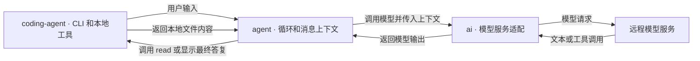

# 实践课 4：Pi Agent 的模型调用与运行流程

实验使用小组的 [Pi 源码仓库](https://github.com/Learning-Rate-LR/pi-hunnu-2026)，从本地编译产物运行 Pi v0.86.1，模型为 `deepseek-v4-pro`。

## 源码修改

在 `packages/agent/src/agent-loop.ts` 中加入两条输出到标准错误的日志。

| 截图 | 插入位置 | 含义 |
| --- | --- | --- |
| [S1](images/S1.png) | `streamAssistantResponse` 中，`await streamFunction(...)` 之前 | Agent 即将进入一次模型调用 |
| [S2](images/S2.png) | `for (const result of toolResults)` 内，紧接 `currentContext.messages.push(result)` | 一条工具结果已写入当前消息上下文 |

## 构建与启动

在项目根目录执行 `npm.cmd run build`。构建生成了 `packages/coding-agent/dist/bundle`，返回 PowerShell 提示符，随后读取 `$LASTEXITCODE` 得到 `0`。见 [S3a](images/S3a.png)、[S3b](images/S3b.png)、[S3c](images/S3c.png) 和 [S3d](images/S3d.png)。

执行 `node .\packages\coding-agent\dist\cli.js` 后进入 Pi 交互界面，见 [S4](images/S4.png)。

## 实际运行记录

附件中的交互式记录包含三条连续输入。前两条是直接问答，第三条读取文件。以下按输入拆分累计日志，原始证据见 [S5](images/S5.png)、[S5 日志](images/S5-log.png) 及 [S6a](images/S6a.png)、[S6b](images/S6b.png)、[S6c](images/S6c.png)。

### A 直接问答

实际输入为 `git分支呢`，上一条输入是 `请用一句话解释git`。两条输入各进入一轮模型调用，都没有调用工具。Git 分支这一轮新增了下面一条日志。

```text
[P4] Agent 即将请求模型
```

Pi 回复：

> Git 分支是一条独立的开发线，让你在隔离的环境中开发新功能或修复问题，完成后再合并回主分支，互不干扰。

### B 读取文件

实际输入为 `请用 read 工具读取当前目录的 practice4.txt，并告诉我文件中的实验代号。 请用readg工具读取当前目录的practice4.txt`。Pi 调用了一次 `read`，打开 `practice4.txt` 第 1 行，进入两轮模型调用。工具结果日志出现在两条模型调用日志之间。

```text
[P4] Agent 即将请求模型
[P4] 工具结果已加入上下文
[P4] Agent 即将请求模型
```

Pi 回复：

> 文件中的实验代号是：EXPT-04-LIU

## 调用流程



A 的模型直接返回文本，Agent 随即结束该轮处理。B 的首轮模型返回工具调用和文件路径。本机上的 `coding-agent` 执行 `read` 并读取第 1 行。`agent` 追加工具结果后发起第二轮请求，上下文包含首轮模型的工具调用和对应的工具结果消息，其中带有文件内容 `EXPT-04-LIU`。远程模型从该消息获得代号并生成最终答复。

## 两个独立会话的复跑记录

在源码根目录从同一编译产物启动两次 CLI，均指定 `--no-session --provider deepseek --model deepseek-v4-pro`。A 使用 `-p` 获取最终文本，B 加上 `--mode json` 记录工具事件。两个进程均以退出码 0 结束。

### A 直接问答

输入：请直接用一句话解释什么是 Git 分支。

没有调用工具，进入 1 轮模型调用。

```text
[P4] Agent 即将请求模型
```

> Git 分支是同一个代码仓库中一条独立、可并行演进的提交历史线，让你在不影响主线的情况下开发新功能或修复问题，之后再合并回去。

### B 读取文件

输入：请用 read 工具读取当前目录的 practice4.txt，并告诉我文件中的实验代号。

事件流记录了一次 `tool_execution_start`，工具是 `read`，路径是 `practice4.txt`。进入 2 轮模型调用，日志顺序如下。

```text
[P4] Agent 即将请求模型
[P4] 工具结果已加入上下文
[P4] Agent 即将请求模型
```

> 文件中的实验代号是：`EXPT-04-LIU`
